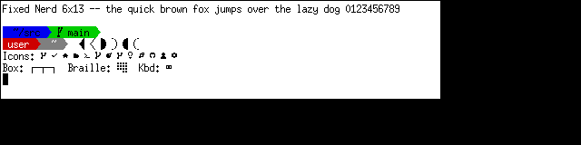

# Fixed Nerd

The classic X11 **misc-fixed 6x13** bitmap font (the default `fixed` / uxterm font), extended with
**Powerline** separators and **Nerd Font** icons so that Powerlevel10k, starship, lsd/eza, vim/neovim
statuslines and other TUIs render properly in xterm/uxterm while keeping that crisp 6x13 look.



- 4121 original glyphs, untouched (Latin, Greek, Cyrillic, box drawing, braille, ...)
- 2358 added glyphs: Powerline (U+E0A0–E0D7), Seti, Devicons, Font Awesome (+Extension), Codicons, Octicons
- Same 6x13 cell, X11 core font (BDF/PCF), no fontconfig tricks needed
- Everything is generated by the scripts in `scripts/`; nothing is drawn in a GUI editor

Icons are downsampled to a single 6x13 cell, so they are *recognizable pixel art*, not pretty
vectors. Glyphs outside the included sets (emoji, Material Design icons, brand logos) are not included.

## Install (per user, X11)

```sh
git clone https://github.com/jaderfeijo/fixed-nerd && cd fixed-nerd
scripts/install.sh          # needs bdftopcf + mkfontdir (apt: xfonts-utils)
uxterm -fn '-jaderfeijo-FixedNerd-medium-r-semicondensed--13-120-75-75-c-60-iso10646-1'
```

Make it the default for xterm/uxterm in `~/.Xresources` (then `xrdb -merge ~/.Xresources`; new terminals only):

```
XTerm*font: -jaderfeijo-FixedNerd-medium-r-semicondensed--13-120-75-75-c-60-iso10646-1
```

and add `xset +fp ~/.local/share/fonts/X11/fixed-nerd` to your X startup so the font path survives restarts.
For Powerlevel10k choose the *Nerd Font* style in `p10k configure`.

## Rebuild

Requires `python3`, `python3-pil`, `curl`, `xz`, and for the preview `xvfb`, `xterm`, `imagemagick`.

```sh
scripts/fetch-upstream.sh   # pinned upstream BDFs  -> upstream/
scripts/fetch-symbols.sh    # pinned Nerd Fonts v3.5.1 symbols -> build/symbols/
scripts/build.py --verify --out dist/fixed-nerd-6x13.bdf
scripts/preview.sh docs/preview.png    # renders on a throw-away Xvfb display
```

| Script | Purpose |
|---|---|
| `scripts/bdf.py` | minimal BDF reader/writer |
| `scripts/powerline.py` | procedural/hand-drawn Powerline glyphs |
| `scripts/rasterize_icons.py` | glyph ranges + downsampling of Nerd Font icons to 6x13 |
| `scripts/build.py` | merges everything; `--verify` proves upstream glyphs are unchanged |
| `scripts/install.sh`, `scripts/preview.sh` | install for the current user / render a test image |

## Licenses and credit

- Base font: public domain (X.Org misc-fixed; Markus Kuhn et al.).
- Added glyphs: MIT, CC BY 4.0 (Font Awesome, Codicons) and OFL-related terms for Font Awesome — see
  **[NOTICE.md](NOTICE.md)** (per-range attribution and the statement of changes) and `LICENSES/`.
- Scripts and docs: MIT, see [LICENSE](LICENSE).

Keep NOTICE.md and `LICENSES/` with any redistributed copy of the font.
